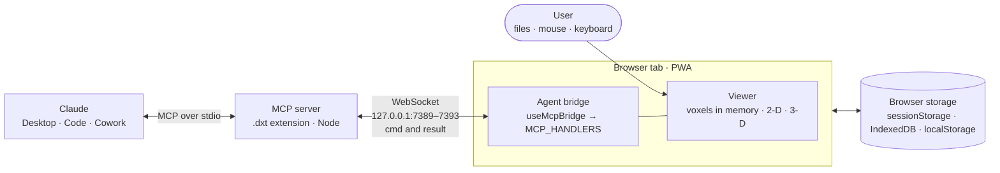
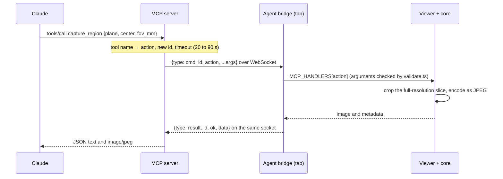
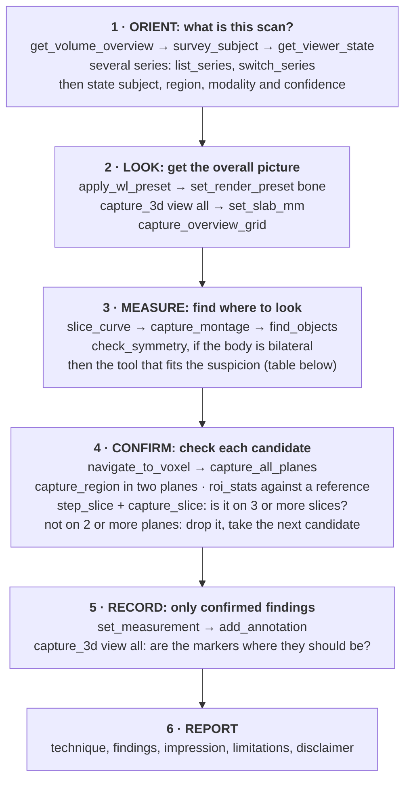

# PrismaMRI architecture

How the app works today: what runs where, how a scan gets on screen, and how an AI agent drives it. Wire format: [`PROTOCOL.md`](PROTOCOL.md). What the voxel analysis can and cannot do: [`RESEARCH.md`](RESEARCH.md).

> For research and education only. Analysis results are candidates for a person to check, not a diagnosis.

## 1. The big picture

Two processes run on one machine. The browser tab holds the volume in memory and draws it. An MCP server, started by Claude Desktop as an extension, turns tool calls into commands for the tab.

**The voxels stay in the tab.** Claude receives a few lines of numbers and JPEG captures, so the size of the volume does not change the size of an answer.

- **One server per surface.** Claude Desktop starts a separate server for chat and for Cowork and Code sessions. Each binds the first free port of `7389–7393` on `127.0.0.1`.
- **The tab finds them.** It probes all five ports in parallel (300 ms timeout), keeps a socket to every server that answers, and looks again every 15 s for one that started later. A reply goes back on the socket the command came from.
- **The skill travels with the server.** It is sent to Claude as MCP instructions, and the `.dxt` lists it for Claude Desktop. To also list it among Claude Code's own skills, start the server with `PRISMAMRI_INSTALL_SKILL=1`: it copies `SKILL.md` to `~/.claude/skills/prisma-mri-radiology/`. Nothing is written outside the server's own folder unless that variable is set.

## 2. Code layers

Two packages that could be published on their own, plus the app. Dependencies point down only; `scripts/check-boundaries.mjs` enforces it in `npm run lint`. The package names are build aliases onto `src/viewer-core` and `src/viewer-react`; nothing is on npm yet.

| Layer | Path | What is in it |
| --- | --- | --- |
| **App** | `src/` | Import screen and routes (`/` import, `/viewer` lazy, `HashRouter`). Agent bridge (`useMcpBridge`, `useBridgeLeadership`, `lib/mcp`). Agent panel and PDF report, plugged in as slots. IndexedDB cache (`volumeDb`) and findings storage. styled-components. |
| **`viewer-react`** | `src/viewer-react` | `<Viewer>` and everything to drive it from outside. `createViewer()` returns one object: state and commands, the loader (`load`, `switchSeries`, `onVolumeLoaded`), events and `surfaces`. A Zustand store per viewer, so several viewers on a page are independent. CSS Modules, `--pmri-*` tokens, features, labels, slots. |
| **`viewer-core`** | `src/viewer-core` | No React. `import/` (DICOM, NIfTI, NRRD, MHA adapters, folder scan, series), `worker/` (`volume.worker`), `volume/` (LPS orientation, slices and slab MIP, 3-D texture, `ThreePreview`), `analysis/` (pure functions). Depends only on `fflate` and `three`. |

The `/unstable` entry points carry no semver: small helpers in `viewer-core`, and the store, `Tooltip`, focus trap and constants in `viewer-react`. `viewer-core/analysis` holds the voxel analysis; `viewer-core/testing` holds the synthetic volumes it is tested against, and the app imports it only from test files.

## 3. From file to screen

| # | Step | What happens |
| --- | --- | --- |
| 1 | **Source** | Drag-and-drop, picker or example URL become an `ImportSource`: files plus format hints (`ImportOverlay`, `useViewerApp`). |
| 2 | **Loader** | `viewer.load(source)` runs one import at a time; a new one cancels the previous. With several series it stops and waits for the user's choice (`SeriesPickerModal`). |
| 3 | **Web Worker** | The adapter builds the voxels (`Int16Array` or `Float32Array`), orientation goes to LPS. The worker also builds the histogram, an 8-bit 3-D texture of at most 512 voxels per axis, and an occupancy map. |
| 4 | **Store** | `setVolume` and the `onVolumeLoaded` listeners run in one synchronous React commit (`flushSync`), so the app swaps screens without a frame in between. |
| 5 | **App reacts** | Navigates to `/viewer`, then saves the volume (and series files) to IndexedDB so a reload does not lose it. |
| 6 | **Drawing** | Three slice panels (canvas, window/level, slab MIP) and a three.js 3-D view, sharing cursor, active plane and preset. |

## 4. One agent command

Every tool is a message with an `id` and a reply with the same `id`. The server waits for the reply with a timer; the tab runs the command on data already in memory.

The server does not validate arguments: it maps the tool name to an action, picks the timeout and forwards. The checks are in the tab (`validate.ts`).

- **One tab leads.** The bridge belongs to one tab, chosen with Web Locks (`prismamri-mcp-bridge`). Others queue and take over when the leader closes.
- **Dead connections.** The server pings every 15 s and drops a socket after two missed pongs. The tab closes its socket after 40 s without a ping.
- **Background tabs.** The tab is usually hidden (the user is in Claude Desktop), so captures wait for a paint at most 250 ms, and the 3-D capture renders its own frame.
- **Who may connect.** `127.0.0.1` only, and the `Origin` is checked: the published PWA, any loopback origin, and `PRISMAMRI_ALLOWED_ORIGINS`. No Origin means refused.

## 5. Where things are stored

User files are never uploaded.

| Store | Holds | Lifetime |
| --- | --- | --- |
| **Tab memory** | Voxels, 3-D texture, histogram, viewer store, files of the open study. | Until the tab closes. |
| **`sessionStorage`** `prisma-mri-ui-state` | Cursor, plane, toolbar, window/level, preset, slab, measurement, mobile tab, active finding (written throttled), and the tab id for IndexedDB. | Per tab, survives a reload. |
| **IndexedDB** `prisma-mri` | The tab's volume with texture and histogram, series metadata and files. A save is skipped if it would take over half of the free quota. | Other tabs' records older than 24 h are removed on save. |
| **`localStorage`** `prismamri.annotations.v2` | Findings, one slot per volume ID; each finding knows its series. | Shared by all tabs. |

After a reload `ViewerPage` takes the volume from IndexedDB and calls `restoreVolume`, which keeps the saved UI state.

## 6. Studies with several series

A DICOM folder often holds T1, T2, FLAIR and a localizer. The viewer opens one series and keeps the files of the others, so it can switch in place.

- **State:** `seriesList`, `activeSeriesKey`, `switchingSeriesKey`, `otherSeriesAnnotations`.
- **UI:** selector in the top-left of the stage, `[` and `]` keys (no wrap-around), a "Loading series" veil. Jumping to a finding on another series switches the series first.
- **Agent:** `list_series`, `switch_series`. A finding belongs to the series it was placed on.

## 7. MCP tools

34 tools in seven groups; every command is specified in [`PROTOCOL.md`](PROTOCOL.md). The rules for using them (`SKILL.md`) are bundled into the extension, and the server also installs them for Claude Code. Timeouts: 20 s by default, 25–40 s for 3-D, all planes, close-ups and overview, 60 s for analysis and montage, 90 s for `switch_series` and the overview grid.

### What each tool does

**Overview and series**

| Tool | What it does |
| --- | --- |
| `get_viewer_state` | Cursor, slice indices, dimensions, window/level, render preset, series, and existing findings and measurement. |
| `get_volume_overview` | Metadata (modality, spacing, declared fields) plus the three centre slices as images. |
| `list_series` | Series of the open study with their finding counts. |
| `switch_series` | Opens another series in place. Resets the crosshair, window/level and 3-D preset. |

**Navigation**

| Tool | What it does |
| --- | --- |
| `navigate_to_slice` | Goes to an absolute slice on a plane. |
| `step_slice` | Moves ±N slices on a plane. |
| `navigate_to_center` | Jumps to the centre of the volume. |
| `navigate_to_voxel` | Puts the crosshair on a voxel, for example one a tool reported. |

**Display**

| Tool | What it does |
| --- | --- |
| `set_window_level` | Sets window and level by hand. |
| `apply_wl_preset` | Named preset: `full_range`, `t1`, `t2`, `flair`, `soft_tissue`, `bone`, `high_contrast`. |
| `set_render_preset` | 3-D mode: `mip`, `tissue` or `bone`. |
| `set_slab_mm` | Slab MIP thickness, 0 to 50 mm (0 = a single slice). |

**Captures** (images are JPEG, long edge 512 px; analysis captures up to 1280 px)

| Tool | What it does |
| --- | --- |
| `capture_slice` | One plane, optionally as a slab MIP. |
| `capture_3d` | The 3-D render: current view, or `all` for three views without moving the user's camera. |
| `capture_all_planes` | Coronal, sagittal and axial at the cursor. |
| `capture_overview_grid` | N evenly spaced slices of one plane. |
| `capture_region` | A close-up cropped from the full-resolution slice (`fov_mm` 5–400); reports mm per pixel. |
| `capture_montage` | Up to 20 captioned slices on one sheet. |

**Voxel analysis** (numbers computed from the voxels; candidates, not diagnoses)

| Tool | What it does | Returns |
| --- | --- | --- |
| `survey_subject` | Size, shape, mirror symmetry, density classes, declared body part and species. | Subject summary. |
| `roi_stats` | Statistics inside a sphere or box. | Mean, SD, percentiles, volume. |
| `line_profile` | Samples intensity along a line. | Values and the steepest edge. |
| `slice_curve` | One number per slice along an axis. | A curve of at most 120 values and peaks. |
| `find_objects` | Separate connected objects, optionally splitting touching ones. | Volume, centroid, extent, long axis per object. |
| `axis_profile` | Follows one object along its long axis. | Length, straightness, sharpest bend, diameter per segment. |
| `check_arrangement` | Whether objects form a regular row. | Per-object offset, lean and spacing; a `warning` if the selection is not a row. |
| `check_symmetry` | Best mirror plane; what has no counterpart on the other side. | Side volumes, asymmetry profile, unmatched parts. |
| `find_gaps` | Thin gaps cutting dense material (crack candidates). | Candidates with width, area and position. |

**Findings and measurement**

| Tool | What it does |
| --- | --- |
| `add_annotation` | Places a finding: plane, voxel, label, summary, severity, `confidence` 0–100, optional `size_mm`. Returns its id. |
| `remove_annotation`, `list_annotations`, `clear_annotations` | Remove one finding, list all (each with its series), remove all. |
| `set_measurement`, `get_measurement`, `clear_measurement` | Place, read and clear the distance measurement. |

### The standard AI analysis flow

The agent does not simply look at pictures. The skill makes it follow six steps, so that it knows what it is looking at before it reads anything, and so that no suspicious spot becomes a finding until it has been checked from several sides.

**Words used below**

- **Voxel**: a 3-D pixel. The volume is a grid of them.
- **Plane**: a way of cutting the volume. *Axial* looks from above, *coronal* from the front, *sagittal* from the side.
- **Window/level (W/L)**: which range of values is stretched to black-to-white. A picture shows one range only, which is why the agent also measures the voxels.
- **Slab MIP**: several neighbouring slices merged into one image, so a crack or vessel that runs across slices is visible in a single picture.
- **Candidate**: a spot a tool points at. It becomes a finding only after step 4.
- **Partial-volume artefact**: a smudge where a slice cuts a thin or tilted structure at an angle. It can look like a lesion but is not one.

Steps 4 and 5 repeat for every candidate.

| Step | The question it answers | Why it is done this way |
| --- | --- | --- |
| **1 Orient** | What am I looking at: human or animal, which body part, CT or MRI? | Fields declared in the file can be wrong, and "normal" depends on the species. The agent says what it thinks and how sure it is, and asks the user if it cannot tell. |
| **2 Look** | What does the whole scan look like? | A 3-D bone view and a few thumbnails work as a map. The agent counts structures, compares left and right, and notes anything missing or extra before zooming in. |
| **3 Measure** | Where should I look, and how big is it? | Pictures are small and 8-bit. The tools read the real voxels and answer in numbers: where the subject is, how many separate objects there are, which side lacks a counterpart. They only point at places. |
| **4 Confirm** | Is the candidate real? | A round "lesion" on one plane may be a tilted tooth or vessel cut across. A real finding shows on at least two planes and several slices, and differs from a reference region or the other side. |
| **5 Record** | Where exactly is it, how big, how sure? | The marker goes at the centre of the finding. Sizes come from `set_measurement`, never estimated from a picture. Confidence is a separate number from 0 to 100, never 100. |
| **6 Report** | What goes to the user? | A fixed structure, including what the tools could not have seen (their resolution and threshold). It describes; it does not diagnose. |

**Which tool for which suspicion** (step 3, and what to be careful about)

| Suspicion | Start with | Be careful |
| --- | --- | --- |
| Missing or extra part | `check_symmetry` (the unmatched list), the count from `find_objects`, a shortened `slice_curve` | Needs a bilateral body with mirror overlap of at least 0.85. A couch or a sideways posture lowers it: restrict the search with `region` first. |
| Bent, shortened or thin bone | `axis_profile` on the bone, then on the other side | Bones touching a joint merge into one object. A normally curved bone also shows a bend, so compare both sides. |
| Crack or fracture line | `find_gaps`, then `capture_region` across it in two planes | CT only. Sutures, joint spaces and canals look the same to the tool, and a hairline narrower than a voxel is missed. |
| Displaced fragment | `find_objects`: one bone shows up as two close objects | Joints legitimately separate bones. |
| Misplaced or tilted tooth or vertebra in a row | `find_objects` with `split_touching`, a `capture_montage`, pick the objects that really are the row, then `check_arrangement` with `object_ids` | If the answer carries a `warning`, the selection is wrong: fix it before reading any flag. |
| Density change | `roi_stats` against a reference region, `slice_curve` | MRI absolute values are arbitrary: compare within the same scan. |

A negative result is only as strong as the resolution and threshold the tool reports: "no gap found at 0.5 mm" does not rule out a narrower crack.

## 8. Decisions and limits

- **Data stays in the browser.** Voxels never go through MCP.
- **Numbers first, pictures second.** Analysis finds places, captures examine them at native resolution.
- **A core without React.** File reading, geometry and analysis are testable in Node and publishable separately.
- **Candidate, not finding.** Each analysis reports its threshold and resolution; the agent confirms on several planes.

**Known limits**

- Analysis runs on the main thread: a large volume can freeze the UI for seconds, and the analysis timeout is 60 s. A Web Worker is the next step.
- Volumes above about 24 million voxels are analysed on a coarser grid; answers carry `resolutionVoxels`.
- Server changes reach Claude Desktop only after the `.dxt` is rebuilt, reinstalled and the app fully restarted.
- The agent-level evaluation has not been done. See [`RESEARCH.md`](RESEARCH.md).
- Moving the viewer into its own repository and npm packages is planned but parked.
